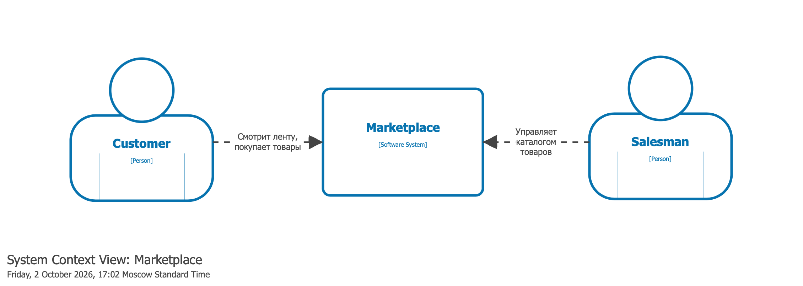
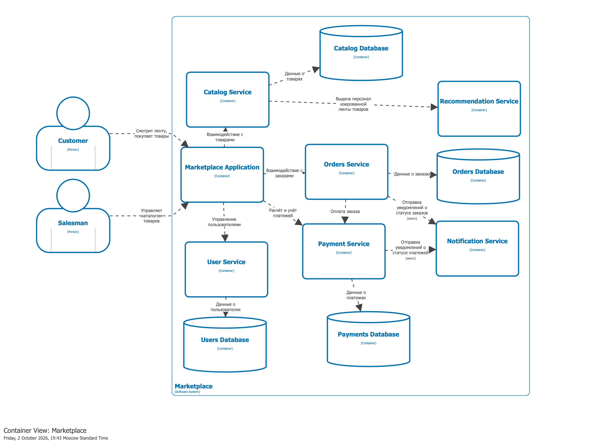

# Marketplace Architecture

## 1. C4 System Context


## 2. C4 Container


## 3. Архитектура

- `Marketplace Application` - принимает запросы от покупателей и продавцов и маршрутизирует их в нужные backend-сервисы.

- `Catalog Service` - отвечает за товары, категории, карточки товаров, цены и доступность. Содержит свою базу данных `Catalog Database`.

- `Recommendation Service` - рекомендательный сервис, отвечает за ленту товарых, которую видит пользователь.

- `Order Service` - создание заказа, состав заказа, статусы заказа, связь с оплатой. Содержит свою базу данных `Order Database`.

- `Payment Service` - учёт, расчёт платежей. Содержит свою базу данных `Payment Database`.

- `Notification Service` - отправка уведомлений о статусах заказа.

- `User Service` - получает информацию о пользователе, о его роли. Содержит свою базу данных `Users Database`.

## 4. Домены и их ответственность

`User Domain` - управление пользователями маркетплейса: покупателями и продавцами, их профилями и ролями.

`Catalog Domain` - управление товарами, категориями, ценами, описаниями и доступностью товаров.

`Order Domain` - создание и хранение заказов, состав заказа, изменение статусов заказа.

`Payment Domain` - обработка платежей, хранение информации о транзакциях и статусах оплаты.

`Recommendation Domain` - формирование персонализированной ленты товаров для покупателя.

`Notification Domain` - отправка уведомлений пользователям об изменениях статусов заказов и платежей.

## 5. Распределение доменов по сервисам

Каждый сервис имеет свою зону ответсвенности и может изменяться независимо от остальных, поэтому каждый домен вынесен в свой сервис:

- `User Domain` -> `User Service`
- `Catalog Domain` -> `Catalog Service`
- `Order Domain` -> `Order Service`
- `Payment Domain` -> `Payment Service`
- `Recommendation Domain` -> `Recommendation Service`
- `Notification Domain` -> `Notification Service`

## 6. Границы владения данными

Сервисы не обращаются напрямую к базам данных других сервисов.

`User Service` владеет: пользователями, ролями, профилями.
Хранилище: `Users Database`.

`Catalog Service` владеет: товарами, категориями, ценами, описаниями.
Хранилище: `Catalog Database`.

`Order Service` владеет: заказами, составом заказа, статусами.
Хранилище: `Orders Database`.

`Payment Service` владеет: платежами, идентификаторами транзакций, статусами оплаты.
Хранилище: `Payments Database`.

## 7. Взаимодействие процессов

В большинстве случаев нужно мгновенное взаимодействие, поэтому используется HTTP. Для уведомлений используется брокер сообщений.

`Marketplace Application` -> `User Service` - синхронно, HTTP
`Marketplace Application` -> `Catalog Service` - синхронно, HTTP
`Marketplace Application` -> `Order Service` - синхронно, HTTP


`Order Service` -> `Payment Service` - синхронно, HTTP

`Order Service` -> `Notification Service` - асинхронно
`Payment Service` -> `Notification Service` - асинхронно

## 8. Варианты декомпозиции

- Вариант 1 - мелкоспециализированные сервисы:

```
User Service
- пользователи
- продавцы
Catalog Service
- каталог
Order Service
- заказы
Payment Service
- платежи
Recommendation Service
- рекомендации
Notification Service
- уведомления
```

_Плюсы_: чёткие границы ответсвенности, лёгкая масштабируемость, отказоустойчивость.
_Минусы_: много вызовов, загруженность сети, сложный деплой.

- Вариант 2 - широкоспециализированные сервисы:

```
User Service
- пользователи
- продавцы
Commerce Service
- каталог
- заказы
- платежи
Communication Service
- рекомендации
- уведомления
```

_Плюсы_: простая разработка, тестирование, легче нагрузка на сеть, легче деплой.
_Минусы_: сложное независимое масштабирование, домены сильно связаны между собой.

## 9. Обоснование финального выбора

Независимая масштабируемость, отказоустойчивость, четкие границы ответственности явно намного круче сопутсвующих проблем или плюсов альтернативного подхода. Ну и как минимум, это намного интереснее. Поэтому в моей реализации заложен первый вариант декомпозиции.

## 10. Демо запуска
Как запустить:

```bash
docker build -t orders-service ./orders-service
docker run -p 8080:8080 orders-service
```

Проверка health-check:

```bash
curl http://localhost:8080/health
```

Ожидаемый ответ:

```json
{
  "service": "order-service",
  "status": "ok"
}
```
